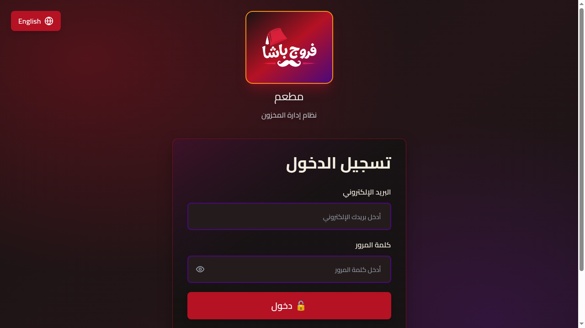

# Faroj Pasha — Restaurant Management UI/UX

A full restaurant management interface designed and built by **Angelo Rezq**. This repository showcases the front-end of the Faroj Pasha system: a complete ordering, production, and reporting workflow for a working restaurant.


## What's inside

- **Point of sale / orders** — take orders, track their status, and move them through preparation.
- **Production tracking** — kitchen-side view of what is being made, from raw ingredients to finished dishes.
- **Products, categories & ingredients** — full menu management with forms, modals, and image handling.
- **Customers** — customer records with order history.
- **Reports & dashboard** — sales and operations dashboards with charts (Chart.js) and Excel export.
- **Shared UI kit** — modals, toasts, loading skeletons, and form components built for speed and consistency.

## Highlights

- Single-page app (React 18 + Vite) with a component library kept deliberately small and reusable.
- Tailwind CSS utility styling with a consistent design system across every screen.
- Optimistic UI patterns: loading skeletons and toast feedback keep the interface responsive during network calls.
- Real operational complexity handled in the UI: order states, production queues, payment methods, and reporting filters.

## Tech

| Layer | Choice |
|---|---|
| Framework | React 18 (Vite) |
| Styling | Tailwind CSS 3 |
| Charts | Chart.js 4 |
| State | React Context |
| Exports | ExcelJS |

## Repository layout

```
ui/
  pages/        Top-level screens (Dashboard, Orders, Production, Products, Reports, ...)
  components/   Shared UI kit (Modal, Toast, LoadingSkeleton, forms, ...)
  contexts/     App state providers
  utils/        Helpers
```

## Screenshots



More screens of the live system are in [`/screenshots`](./screenshots).

## Live demo

The full system (front-end + API) runs at [faroj-basha-systym.vercel.app](https://faroj-basha-systym.vercel.app).

## Author

**Angelo Rezq** — design and front-end implementation.
